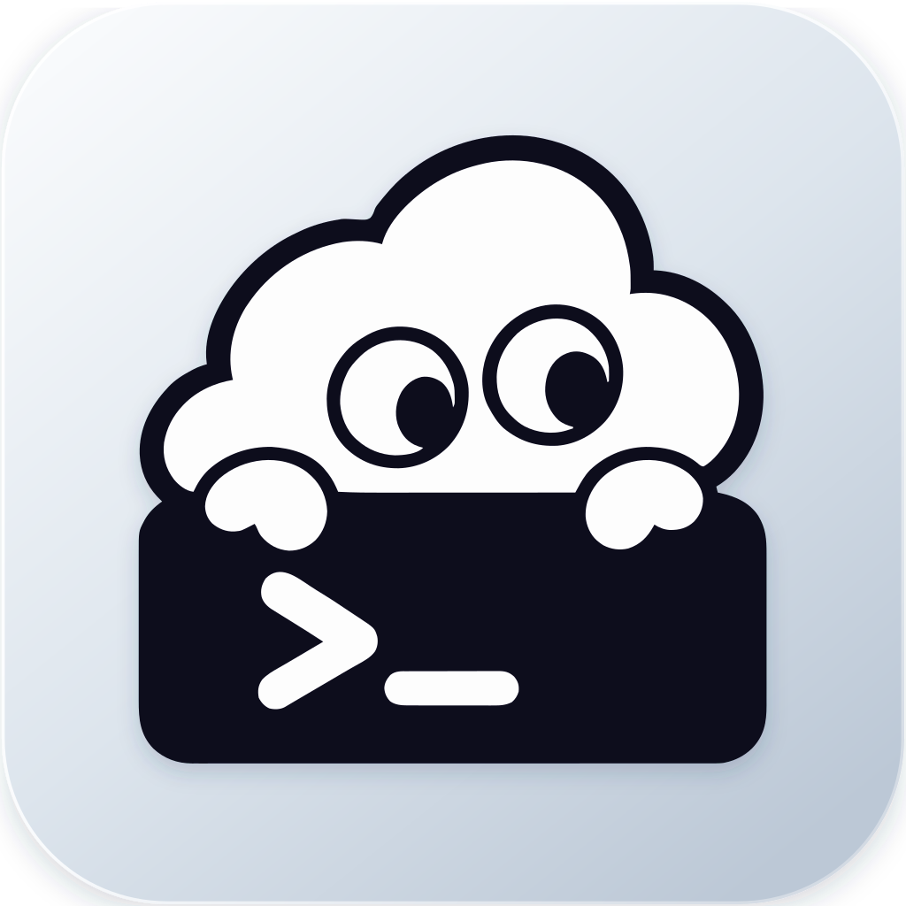

<p align="center">
  
</p>

<h1 align="center">Agmux</h1>

<p align="center"><strong>Your AI, brought together.</strong></p>

<p align="center">
  An open-source all-in-one desktop manager for OpenAI Codex and Claude Code.<br />
  Switch provider profiles for either client in one click, manage your ChatGPT accounts, and centrally manage MCP servers, plugins, and Skills.
</p>

<p align="center">
  <a href="README.zh-CN.md">中文</a> ·
  <a href="https://github.com/zeno528/Agmux/releases/latest">Latest release</a> ·
  <a href="CHANGELOG.md">Changelog</a> ·
  <a href="https://github.com/zeno528/Agmux/issues">Issues</a>
</p>

<p align="center">
  <a href="https://github.com/zeno528/Agmux/releases/latest"></a>
  <a href="LICENSE"></a>
  
  
</p>

Agmux is built for developers who use OpenAI Codex or Claude Code and works with those clients' local environments on your computer. It brings provider profiles, ChatGPT OAuth accounts, MCP servers, plugins, and Skills into one desktop app, reducing the need to move between configuration files and separate tools.

## How Agmux fits into your workflow

```text
Provider preset or existing client configuration
                         ↓
                  Saved as a profile
                         ↓
            Edit · test · use · restore
```

Codex and Claude Code are managed side by side: each client has its own provider page, and using a profile on one never rewrites the other. Agmux backs up the relevant files before switching to a profile. Provider profiles stay separate from global MCP, Plugins, and Skills, so switching providers does not require reconfiguring those resources.

## Features

### Codex provider profiles

- Start from a built-in provider preset, capture the current `~/.codex/config.toml`, or create a custom provider.
- Edit `config.toml`, `models.json`, and `auth.json` with TOML/JSON validation.
- Fetch available models from a provider's `/models` endpoint and select them in the profile editor.
- Rename, duplicate, reorder, delete, and use profiles.
- Keep unrelated Codex configuration such as MCP and plugin sections when switching to a provider where possible.
- Set a custom display name, provider icon, administration URL, optional description, and optional ChatGPT account binding. The description stays inside Agmux and is not written into the Codex configuration.
- Create the official Codex provider from a desktop sign-in you already have: the auth file is read automatically and saved with the profile, so no ChatGPT account has to be bound. The editor shows the desktop identity, and switching such a profile picks up a refreshed desktop token.

### Supported provider presets

The provider picker groups presets into three categories and can search provider names, plan names, and official URLs:

- **Account authorization** — uses the client's own sign-in and needs no endpoint. `ChatGPT` for Codex, `Claude Account` for Claude Code.
- **Plans** — billed by subscription. The plan name follows the provider name so the package is obvious at a glance, for example `MiniMax · M Plan`.
- **Pay as you go** — billed by usage against an API key.

Several plans of the same provider share an icon and a main entry, with the entry name carrying the plan suffix. Xiaomi MiMo is the exception: its pay-as-you-go and Token Plan endpoints differ, so it keeps a single card and switches billing mode inside it instead of splitting the entry. Regional endpoints (CN / Global) are chosen in a version switcher and never enter the entry name.

Each client declares the presets it supports. Presets available on both share a name and icon, but the **endpoint, model, and regional endpoints are filled in independently and never inherited**:

- **Both clients** — `DeepSeek`, `MiniMax`, `Zhipu`, `OpenCode`, `OpenRouter`, `Xiaomi MiMo`, `Kimi`, `Qwen`, `Tencent Hunyuan`, `Volcengine Doubao`, `Baidu Qianfan`, and `Custom`.
- **Codex only** — `ChatGPT`, `xAI (Grok)`.
- **Claude Code only** — `Claude Account`, `Anthropic API`, `SiliconFlow`, `LongCat`.

Some `Qwen`, `Tencent Hunyuan`, and `Baidu Qianfan` plans are not offered on both clients — the picker shows exactly what is available. Custom providers can use the Responses API-compatible configuration supported by Codex, or the Anthropic-compatible configuration supported by Claude Code, with their own endpoint, key, and model catalog.

### Claude Code providers

- Start from a built-in Claude preset, save the current `~/.claude/settings.json` as a snapshot, or create a custom provider.
- Provider fields are written into the `env` block of `~/.claude/settings.json`. The whole file stays editable with JSON validation, and every other top-level key and `env` entry is preserved.
- Pick the `Anthropic-compatible` protocol and a CN or Global endpoint for third-party gateways; the key is written as `ANTHROPIC_AUTH_TOKEN` or `ANTHROPIC_API_KEY` depending on the preset.
- Map request models onto Claude Code's model roles — Main, Fable, Opus, Sonnet, Haiku, and Subagent — or add a custom `/model` entry. The `1M` flag appends `[1m]` to a model ID to request a million-token context.
- `Claude Account` uses the account already signed in to Claude Code: run `/login` there first. Switching to it removes third-party endpoint and credential overrides from `settings.json`, and Agmux neither reads nor stores login credentials.
- Test connectivity against the real `/v1/messages` call path using the stored credentials. Fetching a model list is a separate, optional step — a gateway that exposes no model catalog still passes the connection test.
- Save shared fields as a common template and fill them into any profile. Endpoints, credentials, model mappings, and app-controlled fields are excluded, and template changes never rewrite existing profiles.
- Turn the balance or usage indicator on or off per profile, on the presets that support querying it (currently DeepSeek and MiniMax).
- Open a dedicated terminal for a profile in a chosen project directory: pick the directory from the terminal icon on the card (recently used directories are kept). The active profile starts `claude` with the global configuration; any other profile launches `claude --settings` with that profile as a process-level override. The override file lives in the app's own temporary directory — it never touches `~/.claude` and takes no part in switching a profile or in writing live changes back, so terminal sessions stay independent of each other. On macOS you can choose Terminal.app or Ghostty in settings.
- Advanced options cover auto-compact and its window, effort level, agent teams, auto memory, hiding AI attribution, bypass permissions, and showing shell file changes.

### ChatGPT accounts and usage

- Sign in to ChatGPT in the system browser via OAuth.
- Manage multiple accounts, choose a default account, and bind an account to a provider profile.
- Test ChatGPT authentication and inspect quota information when available.
- Test third-party provider connectivity, including response status and latency.
- View provider balance or usage indicators for supported providers; ChatGPT quota is handled separately.

### MCP management

- Switch the MCP page between Codex and Claude Code. Codex manages the global `[mcp_servers.*]` configuration in `~/.codex/config.toml`; Claude Code manages the user-scope MCP configuration in `~/.claude.json`.
- Configure local `STDIO` servers and remote `HTTP` / Streamable HTTP servers.
- Edit commands, arguments, URLs, bearer-token environment variables, headers, environment variables, and timeouts.
- Test server connectivity and inspect the tools a server provides; probes go through the system proxy and each client is probed and cached separately.
- Enabling, disabling, or uninstalling a server affects only the client you are on — the other client's servers and configuration are left as they are.
- Switch between a structured form and source editing — TOML for Codex, JSON for Claude Code — with validation and formatting.
- Compare the live client configuration with Agmux's database mirror before syncing either direction.

### Plugins and Skills

- List installed Codex plugins and inspect their versions, capabilities, contents, source, and install path.
- Browse bundled and external plugin marketplaces.
- Install states in marketplace catalogs stay consistent with the Codex desktop app — plugins installed here are recognized there directly.
- Installed plugins are listed first in marketplace catalogs; search matches plugin names only via Ctrl/Cmd+K.
- Installing a plugin that requires sign-in prompts you to authorize it in the Codex desktop app.
- Add marketplaces from GitHub shorthand, Git, SSH, or a local marketplace directory.
- Preview and install a plugin from a GitHub repository, optionally using a branch or subdirectory.
- Check and upgrade third-party marketplace plugins, or uninstall plugins through the Codex CLI.
- Import local Skills, preview their `SKILL.md`, detect updates and conflicts, and enable, disable, or delete managed Skills.
- Scan Skills from `~/.codex/skills`, `~/.claude/skills`, and `~/.agents/skills` while keeping the Agmux Skill registry separate from plugin-contained Skills.
- Enable a managed Skill per client: the Codex and Claude Code copies are toggled independently, and each side shows its own enabled count. Deleting a managed Skill removes the Agmux copy and both client copies.

### Agent tools

- Manage **Codex CLI** and **Claude Code CLI** from one page: see whether each is installed and at which version, then install or upgrade it.
- Only native / standalone installations made through the official scripts are managed. If another installation method or multiple copies are detected, Agmux refuses to mix them and explains why. A Codex CLI bundled with the desktop app can coexist with the app and is never taken over.
- Update checks read version information from official channels only, and an upgrade entry appears only once a newer version is confirmed — upgrading always requires an explicit click. Claude Code upgrades run its native `update`; Codex goes through the official installer, whose result and entry point are verified afterwards.
- Update results are shared globally behind a 6-hour cooldown: opening this page triggers one silent check, and a background lazy poll runs hourly. Only a genuinely newer version puts the matching upgrade pill next to that client's provider title, and clicking it upgrades directly.
- The two clients run independent tasks — installing or upgrading one never affects the other.

### Desktop experience

- Windows and macOS desktop builds powered by Tauri 2.
- Light, dark, and system theme modes.
- English and Simplified Chinese interface languages, with system-language detection.
- Optional launch at login, silent start, and minimize-to-tray behavior.
- Choose the page opened on launch; restoring from the tray is unaffected, and the first frame lands on the target page without a flash.
- System tray menu with quick actions: switch profiles, open settings, jump to accounts, and show the main window. Single-click on the tray icon can be set to either show the main window or open the tray menu.
- Optional Codex restart after switching to a Codex profile; Claude Code profiles take effect without restarting anything.
- Optional automatic update checks with release notes before installation, with an "updated to vX" notification on the next launch.
- Local backups of the database, configuration files, and Codex files are created automatically; database backups can be browsed and restored from Settings.

### Settings

The settings page is organized into four tabs:

- **General** — appearance and language (theme, interface language); startup behavior (launch at login, silent start, minimize-to-tray, startup page, macOS terminal app).
- **App** — app and updates (single-click tray action, restart Codex after switching, automatic update checks); ChatGPT account management (OAuth sign-in, multiple accounts, quota and usage, available resets, subscription renewal date, fetch models, and account warm-up).
- **Data management** — database backup: back up now, export to a file, restore from a file, automatic backups (frequency and retention configured independently), rename and delete backups, and collapsible backup records. A restore overwrites all current provider data and cannot be undone, and the MCP configuration inside the backup is written back to `~/.codex/config.toml`.
- **About** — application info card (version, update check, GitHub / changelog links) and the data-and-paths list (app data directory, backups directory, logs directory, Codex configuration).

**Network proxy** gets its own group with three modes:

- **Automatic** — prefers environment variables, then reads the Windows / macOS system proxy; connects directly when neither exists.
- **Off** — forces a direct connection and reads no system proxy settings.
- **Custom** — enter an HTTP(S) proxy address; only valid addresses are accepted.

The proxy applies to the app's own network requests only (balance and usage queries, connectivity tests, plugin marketplaces, app updates, and Agent CLI installs). It is never written into a client configuration and never changes Codex or Claude Code settings. A configured proxy that is invalid or fails to connect never falls back to a direct connection.

### MCP differences

When a client's live configuration and Agmux's MCP mirror drift apart, MCP opens a dedicated diff page that lists every divergent server with a red/green LCS diff and supports batch or single-row `adopt` / `revert` actions. Codex is compared against `~/.codex/config.toml` and Claude Code against the user-scope `~/.claude.json`. Choosing `revert` replaces only the MCP region — the rest of the file is preserved — and a live file that was corrupted externally is never blindly overwritten, so the last valid snapshot survives.

## Download and installation

Download the latest build from the [GitHub Releases page](https://github.com/zeno528/Agmux/releases/latest).

| Platform | Recommended asset | Notes |
| --- | --- | --- |
| Windows x64 | `Agmux-v{VERSION}-Windows-setup.exe` | Standard installer. |
| Windows x64 | `Agmux-v{VERSION}-Windows.msi` | Useful for deployment or MSI-based installation. |
| macOS Apple Silicon | `Agmux-v{VERSION}-macOS-arm64.dmg` | For Apple Silicon Macs. |
| macOS Intel | `Agmux-v{VERSION}-macOS-x64.dmg` | For Intel Macs. |

### macOS first launch

Open the DMG, drag **Agmux** to **Applications**, and launch it. If macOS blocks the app, first allow it in **System Settings → Privacy & Security**. If it still reports that the app cannot be opened, run:

```bash
xattr -cr /Applications/Agmux.app
```

Replace the path if you installed the app somewhere else. Official packages are currently published for Windows and macOS; Linux packages are not included.

## Quick start

1. In the **Codex** group, open **Providers**, add a built-in preset or **Custom**, enter the credentials or bind a ChatGPT account, then use it.
2. In the **Claude** group, open **Providers** to configure Claude Code, or save the current `~/.claude/settings.json` as a snapshot.
3. Enable the optional Codex restart behavior in **Settings → App** if you want Agmux to restart Codex after switching to a profile.
4. Use **MCP**, **Plugins**, **Skill**, or **Agent Tools** under **General** to manage the corresponding global resources. MCP is managed one client at a time, Skills can be enabled for both, and Agent Tools installs or upgrades the Codex CLI and Claude Code CLI.

## Data and privacy

Agmux keeps its application data under the current user's home directory. The exact files and folders depend on which features have been used:

```text
~/.agmux/
├── settings.json
├── agmux.db
├── balance-cache.json
├── logs/
│   └── agmux.log
├── skills/            Agmux-managed Skill repository copies
├── terminal/          per-session override files for Claude Code terminals
├── update-marker
└── backups/
    ├── config/
    ├── database/
    └── codex-files/
```

Agmux keeps its run logs under `~/.agmux/logs/` (1MB × 10 rotation).

When upgrading from a version with the previous name, the app does not migrate its old data directory automatically. Export a database backup from Settings → Data management in the old version, then restore it in Agmux. The old directory is preserved.

Agmux never reads or stores a Claude Code sign-in: a `Claude Account` profile only tells Claude Code to drop third-party endpoint and credential overrides. The Claude common template lives in the Agmux database and is therefore covered by database backups.

API keys, OAuth credentials, profiles, and backups are local data. Agmux creates backups before relevant configuration writes, but you should still avoid committing or sharing `.agmux`, `auth.json`, `~/.claude.json`, API keys, or backup files.

## FAQ and troubleshooting

### What happens when I use a profile?

Agmux backs up the relevant files, updates the provider-related Codex configuration, and preserves unrelated configuration areas where possible. Whether Codex restarts afterward is controlled by **Settings → App**.

### Are profiles, MCP, Plugins, and Skills the same thing?

No. Profiles describe model/provider settings; MCP describes tool servers; Plugins are Codex extension packages; Skills are reusable instruction directories. They are managed in separate areas of the application.

### Does Agmux take over my Claude Code sign-in?

No. Run `/login` in Claude Code itself, then switch to the `Claude Account` profile — Agmux only removes third-party endpoint and credential overrides from `settings.json` so Claude Code uses its own account. It never reads or stores login credentials, and it leaves the shell environment untouched.

### Why can a third-party plugin still fail after a provider is configured?

A model provider configuration does not guarantee that every App or MCP connector plugin can load. Some connector plugins also require compatible official ChatGPT authentication or their own dependencies. Check the plugin's requirements if its package is installed but a connector is unavailable.

### Why did a connection test fail?

For a third-party provider, check the endpoint and API key first. For the official ChatGPT profile, sign in through the account settings and make sure the selected account is still valid. If both look right, suspect the network: under **Settings → Network**, confirm the proxy mode is **Automatic** or that a custom address is actually filled in — an invalid proxy is never silently replaced by a direct connection, so one machine with a dead proxy fails every networked feature at once. Runtime logs live under **Settings → About → logs directory**, where each line carries a domain prefix that identifies the failing area.

## Development

### Requirements

- Node.js
- pnpm `11.9.0`
- Rust toolchain pinned by [`rust-toolchain.toml`](rust-toolchain.toml)
- The platform prerequisites required by Tauri 2

### Install and run

```bash
pnpm install
pnpm dev:tauri
```

`pnpm dev:tauri` starts the Vite frontend and a real Tauri desktop window. For frontend-only browser development, use:

```bash
pnpm dev
```

### Checks and builds

```bash
pnpm typecheck
pnpm test:unit
pnpm check
pnpm build
pnpm build:debug
```

`pnpm check` runs the frontend and Rust quality checks. `pnpm build` creates the web build; `pnpm build:debug` creates a debug Tauri bundle. To package release installers locally:

```bash
pnpm tauri build
```

Release bundles are written under `src-tauri/target/release/bundle/`.

## Architecture

Agmux is built with Tauri 2 + Rust for native file access, process management, and integration with Codex / Claude Code, with a React frontend and a local SQLite database. The app writes only the slice of live configuration it manages, backs up before writing, and writes external edits back into the database when needed.

The main source areas:

```text
src/
├── main.tsx     React entry point
├── style.css    global tokens, layout conventions, and styles
├── presets.ts   provider catalog and preset entries
├── icons.ts     bundled provider icon registry
├── types.ts     shared TypeScript types
├── api/         typed IPC methods and browser mock
├── app/         shell, navigation, state, polling, and management data cache
├── assets/      bundled provider icons and resources
├── components/  shared UI components (AppDialog, AppSelect, ConfigTextEditor, CliUpgradePill, …)
├── features/    profiles, codex, claude, mcp, plugins, skills, accounts, settings, updates
└── i18n/        English and Simplified Chinese messages

src-tauri/src/
├── main.rs           executable entry point
├── lib.rs            Tauri runtime, command registration, and plugin setup
├── commands.rs       Tauri command boundary
├── error.rs          typed application errors
├── fsutil.rs         filesystem helpers (atomic write, …)
├── network.rs        app network policy (automatic / off / custom proxy)
├── services/         AppContext and use cases
│   ├── codex_profiles.rs / codex_apply.rs / codex_profile_config.rs   Codex profile read/write and apply
│   ├── claude.rs / claude_terminal.rs   Claude Code profiles and dedicated terminals
│   ├── cli.rs / codex_cli.rs / claude_cli.rs   Agent CLI install, update check, and upgrade
│   ├── mcp.rs / mcp_probe.rs   MCP mirror, diff handling, and connectivity probes
│   ├── plugins/      plugin and Skill catalog, store, and installation
│   ├── connections.rs / model_fetch.rs   connectivity, balance, and usage
│   ├── settings.rs / storage.rs   app settings and backup storage
│   └── sync/         the timing layer that writes live configuration back to the database
├── codex/           Codex config files, processes, and window state
├── auth/            OAuth and account authentication
├── database.rs      SQLite connection, schema, and migrations
├── models.rs        Rust domain models and command DTOs
├── codex_builtin.rs built-in provider assets and templates
└── paths.rs         filesystem path helpers
```

## Contributing

Bug reports, feature ideas, documentation improvements, and pull requests are welcome. For code changes, run the relevant checks above and keep credentials, local databases, and generated bundles out of commits.

- [Open an issue](https://github.com/zeno528/Agmux/issues)
- [View the changelog](CHANGELOG.md)

## License

Agmux is released under the [MIT License](LICENSE).
